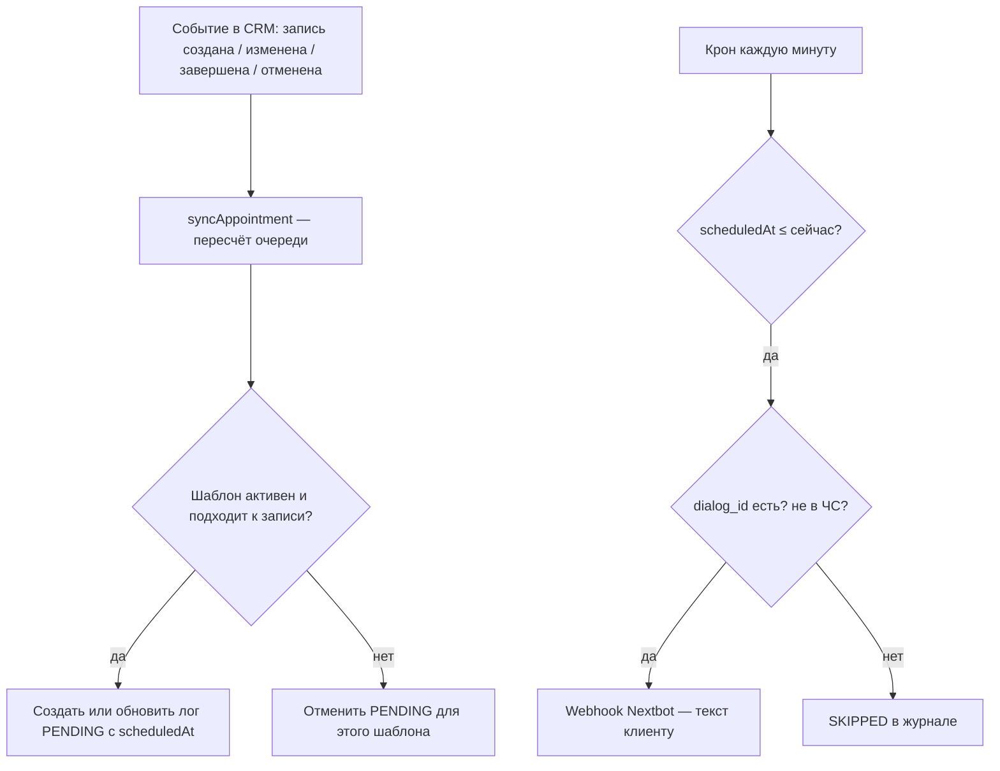

# Автосообщения Nextbot в AIDA — логика сценариев

**PDF:** [`NEXTBOT_AUTO_MESSAGES_SCENARIOS.pdf`](./NEXTBOT_AUTO_MESSAGES_SCENARIOS.pdf) (печатная версия)  
**HTML:** [`NEXTBOT_AUTO_MESSAGES_SCENARIOS.html`](./NEXTBOT_AUTO_MESSAGES_SCENARIOS.html)

**Версия документа:** по состоянию бэкенда AIDA (NestJS + Prisma)  
**Аудитория:** владельцы сети, администраторы, интеграторы Nextbot

---

## 1. Общая схема работы

1. В филиале настраиваются **шаблоны** (текст + тип сценария + тайминг).
2. При изменении записи движок **планирует** отправки (статус `PENDING` в журнале).
3. **Каждую минуту** крон отправляет сообщения, у которых наступило время.
4. Отправка идёт через **webhook организации** (`nextbotOutboundWebhookUrl`), не напрямую из CRM.

### Условия отправки (для всех сценариев)

| Условие | Если не выполнено |
|---------|-------------------|
| У клиента есть `nextbotDialogId` (привязка к диалогу Nextbot) | `SKIPPED` — `no_nextbot_dialog_id` |
| Клиент не в чёрном списке | `SKIPPED` — `client_blacklisted` |
| Запись не отменена | `CANCELLED` в логе |
| Шаблон активен **на момент отправки** | `SKIPPED` — `template_inactive` |
| Задан URL webhook в настройках организации | ошибка при отправке / `FAILED` |

### Важные правила

- **Выключили шаблон:** уже стоящие в очереди `PENDING` **всё равно отправятся**; новые для неактивного шаблона не планируются.
- **Отмена записи (`CANCELLED`):** все `PENDING` по этой записи отменяются.
- **Перенос времени (`startAt`):** пересчитываются напоминания; правило `minLeadDays` проверяется заново.
- **Категория в шаблоне:** для follow-up и оценки **обязательна**; для остальных типов обычно не используется.

### Переменные в тексте

В шаблоне можно использовать `{{ключ}}`:

| Ключ | Содержимое |
|------|------------|
| `name`, `patronymic`, `lastName`, `phone` | Данные клиента |
| `service`, `services`, `category` | Услуга(и) и категория записи |
| `studio` | Название филиала |
| `appointmentDate`, `appointmentTime` | Дата и время визита (часовой пояс филиала) |
| `master` | Имя мастера |
| `comment` | Комментарий к записи |
| `prepayment` | Сумма предоплаты (тенге), если указана |

---

## 2. Сценарий: Подтверждение записи

**Тип в системе:** `BOOKING_CONFIRMED`  
**Подпись в UI:** «Подтверждение записи»

### Когда срабатывает

- Запись переходит в статус **«Забронировано»** (`BOOKED`): создание сразу как BOOKED, подтверждение предброни, оплата через Nextbot и т.п.
- Фиксируется **`bookedAt`** (момент первого/повторного перехода в BOOKED).

### Когда отправляется

- **Сразу** после перехода в BOOKED (смещение в шаблоне не влияет — время = «сейчас»).
- Категория услуг в шаблоне **не фильтрует** (рекомендуется не указывать категорию).

### Типовой текст

> {{name}}, ваша запись подтверждена: {{service}}, {{appointmentDate}} в {{appointmentTime}}, мастер {{master}}, {{studio}}.

### Пресет API

| Поле | Значение |
|------|----------|
| anchor | `NONE` |
| direction | `AFTER` |
| offset | `0` MINUTES |

### Связанные события

- При BOOKED отменяется ожидающее **предупреждение по холду** для этой записи.
- При новой брони в **той же категории** отменяются старые ожидающие **follow-up** и **запрос оценки** этого клиента по этой категории.

---

## 3. Сценарий: Напоминание о визите

**Тип:** `REMINDER_BEFORE_VISIT`  
**Подпись:** «Напоминание о визите»

### Когда планируется

- Запись в статусе **BOOKED**, визит **ещё в будущем** (`startAt` > сейчас).
- Обычно настраивают **два отдельных шаблона** (не один «универсальный»).

### Вариант A — за сутки (24 часа)

| Параметр | Значение |
|----------|----------|
| Смещение | **1 день** до `startAt` |
| minLeadDays | **2** |

**Смысл `minLeadDays`:** напоминание ставится в очередь **только если** между `bookedAt` и `startAt` прошло **не меньше 2 полных суток**.  
Если клиент записался «на завтра», напоминание за сутки **не планируется** (в логе отмена `min_lead_days`).

### Вариант B — за 4 часа

| Параметр | Значение |
|----------|----------|
| Смещение | **4 часа** до `startAt` |
| minLeadDays | не задавать |

Отправляется **всегда** (при активном шаблоне и выполнении общих условий).

### Типовой текст

> Здравствуйте, {{name}}! Напоминаем о записи на {{service}} {{appointmentDate}} в {{appointmentTime}}.

### Перенос записи

- При изменении `startAt` время `scheduledAt` в очереди **пересчитывается**.
- Условие `minLeadDays` **проверяется снова**.

### Отмена

- Статус записи **CANCELLED** → все напоминания по записи отменены.

---

## 4. Сценарий: Истечение брони (ночной холд)

**Тип:** `HOLD_EXPIRY_WARNING`  
**Подпись:** «Истечение брони» / предупреждение по холду

### Когда срабатывает

- Запись в статусе **предварительная бронь** (`TENTATIVE`).
- Заполнено поле **`holdExpiresAt`** (ночной сценарий Nextbot: счёт / оплата с таймером).

### Когда отправляется

- **За 5 минут** до `holdExpiresAt` (типовой пресет).
- Только **до** истечения холда, не после.

### Типовой текст

> {{name}}, ваша предварительная бронь скоро истечёт. Успейте оплатить, чтобы сохранить время: {{appointmentDate}} {{appointmentTime}}.

### Пресет API

| Поле | Значение |
|------|----------|
| anchor | `HOLD_EXPIRES_AT` |
| direction | `BEFORE` |
| offset | `5` MINUTES |

### Отмена / снятие

- Переход в **BOOKED** (или другой «стабильный» статус) → предупреждение по холду **отменяется**.
- Истечение холда без оплаты → запись отменяется отдельным кроном; сообщение не отправляется, если время уже прошло.

### Категория

- **Не используется** (все предброни с холдом в филиале).

---

## 5. Сценарий: Follow-up после визита

**Тип:** `FOLLOWUP_AFTER_VISIT`  
**Подпись:** «Follow-up после визита»

### Это НЕ «клиент 24 дня не ходил»

Движок **не сканирует** всю базу. Логика такая:

1. Конкретный визит перевели в **«Завершено»** (`DONE`).
2. Если категория услуги записи **совпадает** с категорией в шаблоне → в очередь ставится отправка через **N дней** (по умолчанию **24**) после момента завершения.
3. Если **до** этой даты клиент снова записался (**BOOKED**) на услугу **той же категории** → все ожидающие follow-up и запросы оценки по этому клиенту и категории **отменяются**.

Текст «давно не были у нас» — **формулировка в шаблоне**, а не отдельная проверка истории визитов.

### Пример

| Дата | Событие |
|------|---------|
| 1 мая | Визит «Депиляция» → **Завершить** → follow-up на **25 мая** |
| 10 мая | Новая запись на **депиляцию** → BOOKED → follow-up **отменён** |
| 15 мая | Запись на **маникюр** (другая категория) → follow-up по депиляции **не отменяется** |
| 25 мая | Сообщение уходит (если не было отмены и есть dialog_id) |

### Настройка

| Параметр | Типичное значение |
|----------|-------------------|
| Смещение | **24** DAYS после `DONE` |
| Категория | **обязательна** (один шаблон = одна категория) |

### Пресет API

| Поле | Значение |
|------|----------|
| anchor | `VISIT_DONE_AT` |
| direction | `AFTER` |
| offset | `24` DAYS |

---

## 6. Сценарий: Запрос оценки

**Тип:** `FEEDBACK_REQUEST`  
**Подпись:** «Запрос оценки»

### Когда планируется

- Запись в статусе **DONE** (после «Завершить» в CRM).
- Категория записи = категория в шаблоне (**обязательна**).

### Когда отправляется

- Через **N минут** после завершения (пресет: **15 минут**).
- Отправляется **раньше**, чем follow-up (который обычно через дни).

### Что происходит после ответа клиента

1. Клиент получает сообщение с просьбой оценить визит (текст настраивается в шаблоне).
2. Бот Nextbot собирает оценку **1–5**.
3. Бот вызывает API: `POST /nextbot/appointments/:appointmentId/feedback` с `{ "rating": N }`.

### Реакция системы на оценку

| Оценка | Действие AIDA |
|--------|----------------|
| **4–5** | Исходящее сообщение со ссылкой **2GIS** филиала (`feedbackTwoGisUrl` в настройках) |
| **1–3** | Создаётся **задача менеджеру** (заголовок из `feedbackLowRatingTaskTitle` организации) |
| Повторная оценка по той же записи | Отклоняется — одна оценка на визит |

### Отмена

- Те же правила, что у follow-up: новая **BOOKED** в **той же категории** → отмена ожидающего запроса оценки.

---

## 7. Сводная таблица сценариев

| Сценарий | Статус записи | Категория в шаблоне | Когда в очередь | Типовое смещение |
|----------|---------------|---------------------|-----------------|------------------|
| Подтверждение | BOOKED | не нужна | сразу | 0 |
| Напоминание (сутки) | BOOKED, визит в будущем | не нужна | startAt − 1 день | minLeadDays: 2 |
| Напоминание (4 ч) | BOOKED, визит в будущем | не нужна | startAt − 4 ч | — |
| Холд | TENTATIVE + holdExpiresAt | не нужна | holdExpiresAt − 5 мин | 5 мин |
| Follow-up | DONE | **обязательна** | DONE + N дней | 24 дня |
| Запрос оценки | DONE | **обязательна** | DONE + N мин | 15 мин |

---

## 8. Журнал и статусы

В CRM: **GET** `/studios/:studioId/nextbot-auto-messages/logs`

| Статус | Значение |
|--------|----------|
| `PENDING` | Ждёт времени отправки |
| `SENT` | Ушло в Nextbot |
| `SKIPPED` | Не отправлено (нет dialog_id, ЧС, неактивный шаблон) |
| `FAILED` | Ошибка webhook |
| `CANCELLED` | Отменено (отмена записи, новая бронь в категории, не прошло minLeadDays и т.д.) |

---

## 9. Настройка перед запуском

1. **URL webhook** исходящих сообщений Nextbot — в настройках организации/маркетинга.
2. У клиентов — **`nextbotDialogId`** (привязка диалога).
3. Шаблоны по филиалу — через раздел «Автосообщения Nextbot».
4. Для оценок 4–5 — **ссылка 2GIS** на филиал.

---

## 10. Рекомендуемый набор шаблонов на филиал

| № | Сценарий | Заметка |
|---|----------|---------|
| 1 | Подтверждение записи | 1 шаблон на филиал |
| 2 | Напоминание за сутки | minLeadDays = 2 |
| 3 | Напоминание за 4 часа | отдельный шаблон |
| 4 | Предупреждение холда | 5 мин, только ночной холд |
| 5+ | Follow-up | по одному на нужную **категорию** |
| 6+ | Запрос оценки | по одному на **категорию**, обычно 15 мин после визита |

---

*Документ сформирован по коду модуля `nextbot-auto-messages` и `NextbotAutoMessageOrchestratorService` в репозитории AIDA.*
