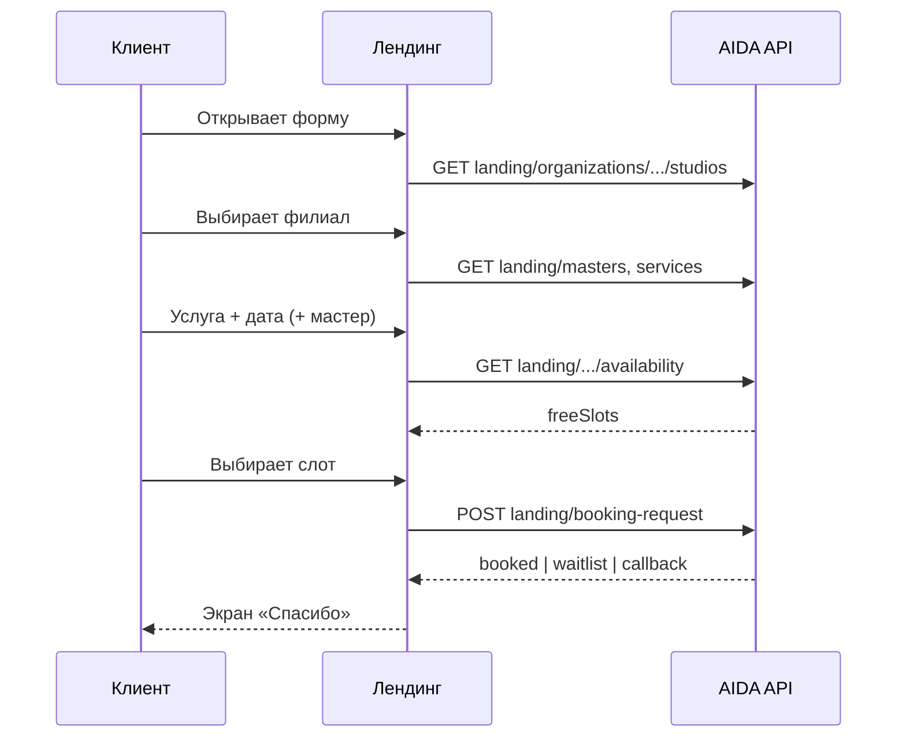

# Промпт для Lovable: рабочая форма «Запись в удобное время» на лендинге

Скопируйте блок **«Задача для Lovable»** в чат. Бэкенд AIDA: публичные эндпоинты для слотов и отправки формы.

**Base URL API:** `https://aidaproject-production.up.railway.app` (или ваш `VITE_API_URL`).

---

## Задача для Lovable

### 1. Цель

Сделать **рабочую** модалку/форму **«Запись в удобное время»** на публичном лендинге салона (тёмная тема, как в макете: филиал, имя, телефон, услуга, мастер, дата/время, комментарий, «Дополнительно»).

Подзаголовок: **«Мы перезвоним и подберём окно»** — но если клиент выбрал **конкретный свободный слот**, система сразу создаёт **запись в CRM** (или ставит в **лист ожидания**, если слот заняли).

### 2. Контекст приложения

- В env лендинга задан **`VITE_ORGANIZATION_ID`** (сеть салонов). JWT CRM на публичной странице **не** использовать.
- **Клиент сам выбирает филиал** в первом поле формы («Филиал»). Это не скрытый `studioId` из env — только `organizationId` в env.
- Выбранный **`studioId`** хранить в состоянии формы и подставлять во все запросы ниже.

### 3. Филиал (первый шаг формы)

При открытии модалки:

1. **`GET /landing/organizations/{organizationId}/studios`**
2. Ответ: `{ organizationId, studios: [{ id, name, address, timezone }] }`
3. Select **«Филиал»**:
   - label: `name` + при наличии `address` (например: `IT-PRO Consulting — Шымкент, ул. Дарвина 5`)
   - value: `id` (`studioId`)
4. Если филиал **один** — автоматически выбрать его, поле можно оставить видимым (read-only) или свернуть в подпись «Филиал: …».
5. Если филиалов **несколько** — без выбора филиала блоки «Услуга», «Мастер», «Дата/время» **disabled** или скрыты.
6. **Смена филиала** — сбросить и перезагрузить: услуги, мастеров, дату, выбранный слот, список `freeSlots`.

### 4. Загрузка справочников (после выбора `studioId`)

| Данные | Метод |
|--------|--------|
| Мастера | `GET /studios/{studioId}/landing/masters` — только `isVisible === true`, сортировка `order`. **«Любой мастер»** = не передавать `staffUserId` в availability до выбора слота. |
| Услуги | `GET /studios/{studioId}/landing/services` — value = `service.serviceId` (или `service.id` из вложенного `service`). |
| Рефералка `?ref=` | `GET /studios/{studioId}/referral-links/resolve/{linkId}` — после выбора филиала; read-only «Источник», в submit `referralLinkId`. |
| Промокод | `POST /landing/promotions/resolve-code` — `{ "code", "organizationId", "studioId" }` (актуальный выбранный филиал). |

### 5. Выбор даты и времени (ключевой UX)

Когда выбраны **филиал + услуга** (и опционально мастер):

1. Пользователь выбирает **дату** (date picker).
2. Запрос слотов:  
   **`GET /landing/studios/{studioId}/availability?date=YYYY-MM-DD&serviceId={serviceId}&staffUserId={optional}`**
3. Ответ содержит **`freeSlots`**: массив `{ staffUserId, startAt, endAt, priority }` (ISO с timezone).
4. UI времени:
   - Если мастер **«Любой»** — показать слоты **всех мастеров** (группировка по времени или плоский список «14:00 — Имя мастера»).
   - При выборе слота сохранить **`startAt`** (точное ISO из слота) и **`staffUserId`** (из слота — обязательно для submit).
5. Пока слоты грузятся — skeleton; пустой массив — «На эту дату нет свободного времени, выберите другую дату».
6. Таймзона: брать **`timezone`** выбранного филиала из списка студий (fallback `Asia/Almaty`). В API `startAt` с offset, напр. `2026-05-24T14:00:00+06:00`.

**Не давайте вручную вводить время текстом**, если есть свободные слоты — только выбор из списка.

### 6. Отправка формы

**`POST /landing/booking-request`** (публично, без Bearer).

```json
{
  "studioId": "stu_xxx",
  "firstName": "Айгуль",
  "lastName": "Опционально",
  "patronymic": "Опционально",
  "instagram": "@username",
  "phone": "+77001234567",
  "serviceId": "srv_xxx",
  "staffUserId": "usr_xxx",
  "startAt": "2026-05-24T14:00:00+06:00",
  "comment": "Пожелания",
  "referralLinkId": "srl_xxx",
  "promoCode": "PROMO2026"
}
```

**Обязательно:** `studioId`, `firstName`, `phone`.

**Два сценария на бэкенде:**

| Условие | Результат `outcome` | Сообщение пользователю |
|---------|---------------------|---------------------------|
| Есть `startAt` + `serviceId` + `staffUserId` (из слота) | `booked` | «Запись создана. Мы свяжемся для подтверждения.» |
| Слот занят, `preferWaitlist` сработал | `waitlist` | «Время занято — вы в листе ожидания, мы свяжемся.» |
| Нет полного набора (нет времени / мастера из слота / услуги) | `callback` | «Заявка принята. Мы перезвоним и подберём время.» |

Ответы 201, пример:

```json
{ "outcome": "booked", "message": "...", "appointmentId": "apt_xxx", "clientId": "cli_xxx" }
{ "outcome": "waitlist", "message": "...", "waitlistEntryId": "wle_xxx", "clientId": "cli_xxx" }
{ "outcome": "callback", "message": "...", "clientId": "cli_xxx" }
```

### 7. Валидация на фронте

- **Филиал** — обязателен (клиент выбрал в select или единственный подставлен автоматически).
- **Имя** — не пустое.
- **Телефон** — маска KZ (+7), минимум 10 цифр; перед submit нормализовать к `+7XXXXXXXXXX`.
- Если пользователь выбрал дату и видит слоты — **нельзя отправить** без выбранного слота (иначе уйдёт в `callback`, а не запись).
- Кнопка «Отправить» disabled + loading при submit.
- Ошибки 400/409 — toast с текстом `message` из ответа или дружелюбный fallback.

### 8. Поля UI (как в макете)

1. **Филиал** — **первое поле**, select из API (см. п. 3); иконка «геолокация»; placeholder «Выберите филиал».
2. **Ваше имя** — input.
3. **Телефон** — маска + флаг KZ.
4. **Услуга** — select, опционально (но нужна для слотов и полной записи).
5. **Мастер** — select: первый пункт «Любой мастер» (`value=""`), далее мастера из API с `isVisible`.
6. **Дата** + **Время** — date picker + select слотов (см. п. 5); активны только после филиала и услуги.
7. **Комментарий** — textarea, optional.
8. **Дополнительно** (accordion) — отчество, Instagram → уходят в body при submit.
9. **Источник** — только при `?ref=`, read-only.
10. Дисклеймер внизу: «Нажимая кнопку, вы соглашаетесь на обработку персональных данных».

### 9. Состояния после отправки

- Success-экран в модалке: иконка ✓, `message` из ответа, кнопка «Закрыть».
- Закрытие модалки сбрасывает форму.
- При `outcome === 'booked'` можно показать: «Номер заявки: {appointmentId}» мелким текстом (опционально).

### 10. Открытие модалки

- Кнопка «Записаться» на лендинге.
- При заходе с **`?ref=`** — авто-открытие после resolve рефералки (как в `LOVABLE_LANDING_CALLBACK_MODAL_PROMPT.md`).

### 11. Не делать

- Не хранить API-ключ Nextbot в браузере.
- Не вызывать `POST /nextbot/.../appointments` с лендинга (это TENTATIVE для чат-бота, не для лендинга).
- Не использовать `POST /clients` с CRM JWT с публичной страницы — всё через **`POST /landing/booking-request`**.
- Не придумывать слоты — только из `freeSlots`.

### 12. Технические заметки

- Созданные с лендинга записи в CRM: **`createdSource: LANDING`**, статус **`BOOKED`** (не предоплата Nextbot).
- Если клиент с таким телефоном уже есть — используется существующий профиль.
- Чёрный список — ошибка 400 с понятным текстом.

---

## Краткая схема потока



---

## Связанные документы

- `docs/lovable/LOVABLE_LANDING_CALLBACK_MODAL_PROMPT.md` — рефералка и поля клиента (устаревший submit только через notes; для записи использовать этот документ).
- `docs/LANDING_PROMOTIONS.md` — промокоды.
