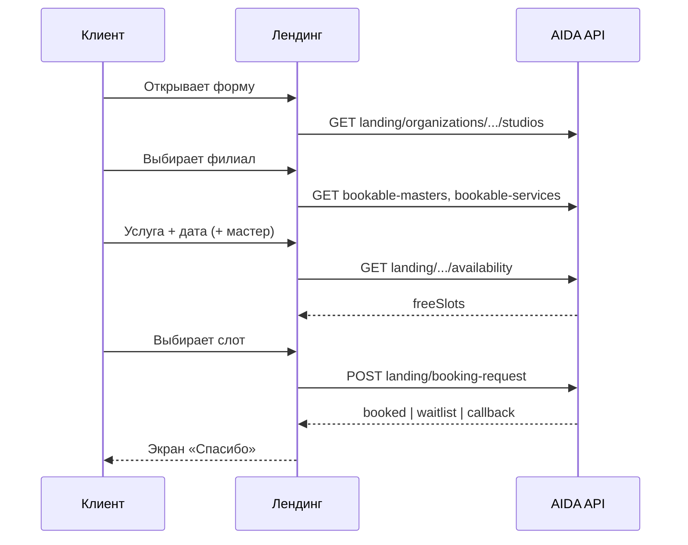

# Промпт для Lovable: рабочая форма «Запись в удобное время» на лендинге

Скопируйте блок **«Задача для Lovable»** в чат. Бэкенд AIDA: публичные эндпоинты для слотов и отправки формы.

**Base URL API:** `https://aidaproject-production.up.railway.app` (или ваш `VITE_API_URL`).

---

## Задача для Lovable

### 1. Цель

Сделать **рабочую** модалку/форму **«Запись в удобное время»** на публичном лендинге салона (тёмная тема, как в макете: филиал, имя, телефон, услуга, мастер, дата/время, комментарий, «Дополнительно»).

Подзаголовок: **«Мы перезвоним и подберём окно»** — но если клиент выбрал **конкретный свободный слот**, система сразу создаёт **запись в CRM** (или ставит в **лист ожидания**, если слот заняли).

### 2. Контекст приложения

- В env лендинга задан **`VITE_ORGANIZATION_ID`** (сеть салонов). JWT CRM на публичной странице **не** использовать.
- **Клиент сам выбирает филиал** в первом поле формы («Филиал»). Это не скрытый `studioId` из env — только `organizationId` в env.
- Выбранный **`studioId`** хранить в состоянии формы и подставлять во все запросы ниже.

### 3. Филиал (первый шаг формы)

При открытии модалки:

1. **`GET /landing/organizations/{organizationId}/studios`**
2. Ответ: `{ organizationId, organizationName, studios: [{ id, name, address, timezone }] }`  
   **Проверка:** в шапке модалки (dev) можно показать `organizationName` — если видите чужое имя организации, в `.env` неверный `VITE_ORGANIZATION_ID`.
3. Select **«Филиал»**:
   - label: `name` + при наличии `address` (например: `IT-PRO Consulting — Шымкент, ул. Дарвина 5`)
   - value: `id` (`studioId`)
4. Если филиал **один** — автоматически выбрать его, поле можно оставить видимым (read-only) или свернуть в подпись «Филиал: …».
5. Если филиалов **несколько** — без выбора филиала блоки «Услуга», «Мастер», «Дата/время» **disabled** или скрыты.
6. **Смена филиала** — сбросить и перезагрузить: услуги, мастеров, дату, выбранный слот, список `freeSlots`.

### 4. Загрузка справочников (после выбора `studioId`)

| Данные | Метод |
|--------|--------|
| Мастера (форма записи) | **`GET /landing/studios/{studioId}/bookable-masters`** — **все** активные мастера/админы филиала. Галочки «на лендинге» в админке **не** влияют на форму записи. **Не** использовать `GET .../landing/masters` в модалке записи. |
| Услуги (форма записи) | **`GET /landing/studios/{studioId}/bookable-services`** — каталог услуг CRM в филиале. В select **value = `serviceId`**, label = `name`. **Не** использовать `GET .../landing/services` в форме — это **карточки витрины** (2–3 штуки), не весь прайс. |
| Карточки витрины | `GET /studios/{studioId}/landing/services` — только для блока «Услуги» на главной странице лендинга, **не** для модалки записи. |
| Рефералка `?ref=` | `GET /studios/{studioId}/referral-links/resolve/{linkId}` — **после** загрузки списка филиалов (любой `studioId` этой организации подойдёт); read-only «Источник», в submit `referralLinkId`. При смене филиала `referralLinkId` **не сбрасывать**. |
| Промокод | `POST /landing/promotions/resolve-code` — `{ "code", "organizationId", "studioId" }` (актуальный выбранный филиал). |

### 5. Выбор даты и времени (ключевой UX)

Когда выбраны **филиал + услуга** (и опционально мастер):

1. Пользователь выбирает **дату** (date picker). **«Сегодня» и запрет прошлых дат** считать в **`timezone` выбранного филиала** (`studios[].timezone`), а не только в TZ браузера.
2. Запрос слотов:  
   **`GET /landing/studios/{studioId}/availability?date=YYYY-MM-DD&serviceId={serviceId}&staffUserId={optional}`**  
   (`staffUserId` — только если в select выбран конкретный мастер, не «Любой».)
3. Ответ: **`freeSlots`**: `{ staffUserId, staffName?, startAt, endAt, priority }`.

#### ⚠️ Время в `startAt`: UTC в API, локальное на экране

Бэкенд отдаёт **`startAt` / `endAt` в UTC** (`toISOString()`, суффикс `Z`), например `2026-05-24T08:00:00.000Z` — это **14:00** в `Asia/Almaty`.

| Действие | Правило |
|----------|---------|
| **Показ в UI** | Конвертировать в часы филиала через **`timezone`** из `GET .../organizations/.../studios`. **Не** парсить время regex `T(\d{2}):(\d{2})` из строки — получите UTC и ошибку на 5–6 часов. |
| **Submit** | Передавать **`startAt` как в ответе слота** (ту же ISO-строку), без пересчёта «для красоты». |
| Подпись мастера | При «Любой мастер» — **`staffName`** из слота или имя из справочника; ключ кнопки: **`staffUserId + startAt`**. |

Пример форматирования для кнопки слота:

```ts
function formatSlotTime(startAtIso: string, studioTimezone: string): string {
  return new Intl.DateTimeFormat('ru-RU', {
    hour: '2-digit',
    minute: '2-digit',
    hour12: false,
    timeZone: studioTimezone || 'Asia/Almaty',
  }).format(new Date(startAtIso));
}
// formatSlotTime('2026-05-24T08:00:00.000Z', 'Asia/Almaty') → "14:00"
```

4. UI времени:
   - Если мастер **«Любой»** — сетка/список «14:00 — {staffName}».
   - При выборе слота сохранить объект слота: **`startAt`** и **`staffUserId`** именно из этого элемента `freeSlots` (не из select «Мастер»).
5. Пока слоты грузятся — skeleton; пустой массив — «На эту дату нет свободного времени»; **submit без слота разрешён** → `callback`.
6. Если **`freeSlots.length > 0`** — выбор слота обязателен перед submit (иначе уйдёт `callback`, а не запись).

**Не давайте вручную вводить время текстом**, пока на дату есть свободные слоты — только выбор из списка.

### 6. Отправка формы

**`POST /landing/booking-request`** (публично, без Bearer).

```json
{
  "studioId": "stu_xxx",
  "firstName": "Айгуль",
  "lastName": "Опционально",
  "patronymic": "Опционально",
  "instagram": "@username",
  "phone": "+77001234567",
  "serviceId": "srv_xxx",
  "staffUserId": "usr_xxx",
  "startAt": "2026-05-24T08:00:00.000Z",
  "comment": "Пожелания",
  "referralLinkId": "srl_xxx",
  "promoCode": "PROMO2026"
}
```

**Обязательно:** `studioId`, `firstName`, `phone`.

**Два сценария на бэкенде:**

| Условие | Результат `outcome` | Сообщение пользователю |
|---------|---------------------|---------------------------|
| Есть `startAt` + `serviceId` + `staffUserId` (из слота) | `booked` | «Запись создана. Мы свяжемся для подтверждения.» |
| Слот занят, `preferWaitlist` сработал | `waitlist` | «Время занято — вы в листе ожидания, мы свяжемся.» |
| Нет полного набора (нет времени / мастера из слота / услуги) | `callback` | «Заявка принята. Мы перезвоним и подберём время.» |

Ответы 201, пример:

```json
{ "outcome": "booked", "message": "...", "appointmentId": "apt_xxx", "clientId": "cli_xxx" }
{ "outcome": "waitlist", "message": "...", "waitlistEntryId": "wle_xxx", "clientId": "cli_xxx" }
{ "outcome": "callback", "message": "...", "clientId": "cli_xxx" }
```

### 7. Валидация на фронте

- **Филиал** — обязателен (клиент выбрал в select или единственный подставлен автоматически).
- **Имя** — не пустое.
- **Телефон** — маска KZ (+7), минимум 10 цифр; перед submit нормализовать к `+7XXXXXXXXXX`.
- Если на выбранную дату **`freeSlots.length > 0`** — **нельзя** отправить без выбранного слота. Если слотов **нет** — можно отправить заявку на перезвон (`callback`).
- Кнопка «Отправить» disabled + loading при submit.
- Ошибки 400/409 — toast с текстом `message` из ответа или дружелюбный fallback.

### 8. Поля UI (как в макете)

1. **Филиал** — **первое поле**, select из API (см. п. 3); иконка «геолокация»; placeholder «Выберите филиал».
2. **Ваше имя** — input.
3. **Телефон** — маска + флаг KZ.
4. **Услуга** — select, опционально (но нужна для слотов и полной записи).
5. **Мастер** — select: первый пункт «Любой мастер» (`value=""`), далее мастера из API с `isVisible`.
6. **Дата** + **Время** — date picker + select слотов (см. п. 5); активны только после филиала и услуги.
7. **Комментарий** — textarea, optional.
8. **Дополнительно** (accordion) — отчество, Instagram → уходят в body при submit.
9. **Источник** — только при `?ref=`, read-only.
10. Дисклеймер внизу: «Нажимая кнопку, вы соглашаетесь на обработку персональных данных».

### 9. Состояния после отправки

- Success-экран в модалке: иконка ✓, `message` из ответа, кнопка «Закрыть».
- Закрытие модалки сбрасывает форму.
- При `outcome === 'booked'` можно показать: «Номер заявки: {appointmentId}» мелким текстом (опционально).

### 10. Открытие модалки

- Кнопка «Записаться» на лендинге.
- При заходе с **`?ref=`** — после **`GET .../organizations/.../studios`** вызвать resolve с любым `studioId` из ответа (или уже выбранным филиалом), затем авто-открыть модалку с бейджем «Источник: …» (см. `LOVABLE_LANDING_CALLBACK_MODAL_PROMPT.md`).

### 11. Не делать

- **Не** вызывать **`GET /studios`** (CRM, JWT; у **DEVELOPER** отдаёт **все** филиалы **всех** организаций — отсюда «IT-PRO», «TEST», «DEMO» в одном списке).
- **Не** подставлять `organizationId` / `studioId` из JWT preview Lovable — только **`import.meta.env.VITE_ORGANIZATION_ID`** (и при необходимости дефолтный филиал из первого элемента ответа API).
- Не хранить API-ключ Nextbot в браузере.
- Не вызывать `POST /nextbot/.../appointments` с лендинга (это TENTATIVE для чат-бота, не для лендинга).
- Не использовать `POST /clients` с CRM JWT с публичной страницы — всё через **`POST /landing/booking-request`**.
- Не придумывать слоты — только из `freeSlots`.
- Не показывать время слота regex по ISO-строке без `timeZone` филиала.

### 12. Технические заметки

- Созданные с лендинга записи в CRM: **`createdSource: LANDING`**, статус **`TENTATIVE`** («Предварительная бронь»). Менеджер подтверждает в CRM → `BOOKED`.
- Если клиент с таким телефоном уже есть — используется существующий профиль (имя/Instagram из формы при повторном визите **не перезаписываются**, обновляются notes при `callback`).
- Чёрный список — ошибка 400 с понятным текстом.
- Гонка за слот: 400 «время недоступно» — предложить выбрать другой слот или отправить без `startAt`.

---

## Частые ошибки (симптомы на скриншотах)

| Симптом | Причина | Исправление |
|---------|---------|-------------|
| В «Филиал» все салоны платформы | `GET /studios` с токеном DEVELOPER | `GET /landing/organizations/{VITE_ORGANIZATION_ID}/studios` **без** Bearer |
| В «Услуга» 0–2 позиции или пусто | Взяли карточки витрины | `GET /landing/studios/{studioId}/bookable-services` |
| В «Мастер» только «Любой мастер» | `landing/masters` + фильтр `isVisible` | `GET /landing/studios/{studioId}/bookable-masters` |
| Другая сеть в филиалах | Неверный `VITE_ORGANIZATION_ID` | В CRM: **Настройки → id организации** салона «ТД Евразия» |

---

## Краткая схема потока



---

## Связанные документы

- `docs/lovable/LOVABLE_BOOKING_STAFF_SERVICE_FILTER_PROMPT.md` — **мастер ↔ услуги** (экраны «Выбор услуг» / «Выбор специалиста»).
- `docs/lovable/LOVABLE_LANDING_CALLBACK_MODAL_PROMPT.md` — рефералка и поля клиента (устаревший submit только через notes; для записи использовать этот документ).
- `docs/LANDING_PROMOTIONS.md` — промокоды.
